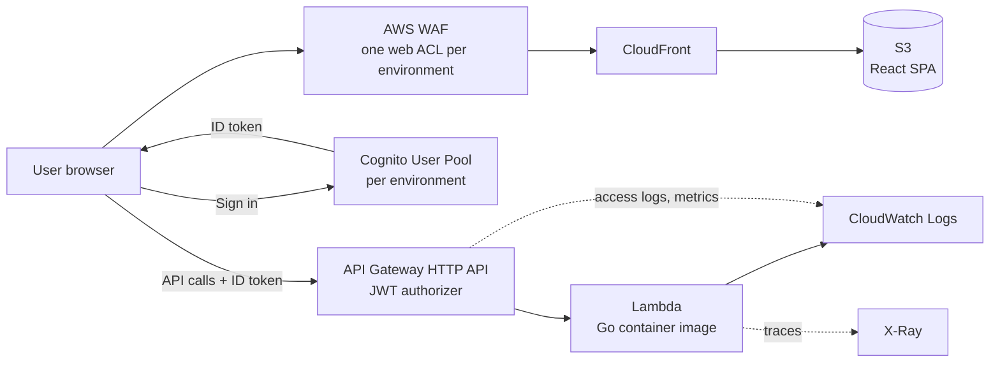

# ADR 0001: Serverless Go and React Platform on AWS

- **Status:** Proposed
- **Date:** 2026-11-21
- **Amended:** 2026-11-21. Scope is the proof, not a Django replacement. Dropped Aurora, the Lambda VPC, and the Cognito Identity Pool. Amazon API Gateway is an HTTP API, and it is used only when deployed. Runtime configuration of the SPA is decided in [ADR 0002](0002-proof-application.md).
- **Revised:** 2026-11-21, after review. API Gateway answers CORS. X-Ray traces Lambda only. Idle cost has a fixed WAF and Route 53 baseline. The database decision no longer cites an Aurora capacity floor.
- **Amended:** 2026-11-22. Added Decision 10: the home region is `us-west-2`.
- **Amended:** 2026-11-23 (T007). The Proof has no domain name, so every environment uses its own `*.cloudfront.net` URL and there is no hosted zone or ACM certificate (Decision 8). Settled open questions 2–4: stack layout, log retention, and the CloudFront flat-rate Free plan. Plan: [platform plan](../plans/2026-11-23-platform.md).
- **Amended:** 2026-11-24 (T010). Dev is removed: a push to master deploys QA, then prod after approval. For one developer, dev duplicated QA. Both deployed the same assets in turn, with the same smoke step and no gate between them. Plan: [remove dev](../plans/2026-11-24-remove-dev-environment.md).
- **Author:** Glenn Bach
- **Scope:** AWS platform for the proof, a Go API and a React SPA with no product domain. The application itself is [ADR 0002](0002-proof-application.md).

---

## Context

This repository holds the proof: a browser interface that calls a Go API. It is not a replacement for an existing product, and it stores nothing.

The deployment goals are:

- Low cost when idle. Pay per use where possible.
- Little infrastructure to maintain. Prefer managed and serverless services.
- Clear isolation between QA and prod, including user identities.
- Repeatable, reviewable infrastructure defined in code.
- Consistency with existing Caltech IT practice for secrets and logging.

### Architecture summary

- **Frontend:** React single-page app (SPA) hosted on Amazon S3 and served through Amazon CloudFront on its `*.cloudfront.net` URL. AWS WAF protects it. The Proof has no custom domain (Decision 8).
- **API:** A Go service packaged as a container image and run on AWS Lambda, behind Amazon API Gateway. This is the AWS product, used only in the cloud. The API is an HTTP API. A JWT authorizer validates the Cognito ID token before any request reaches Lambda. The HTTP API's CORS configuration answers browser preflight requests.
- **Identity:** Amazon Cognito User Pool, one pool per environment. No Identity Pool.
- **Data:** None. The proof has no database.
- **Delivery:** AWS CodePipeline and CodeBuild. Images are stored in Amazon ECR.
- **Operations:** CloudWatch structured logs, API Gateway access logs and metrics, and AWS X-Ray tracing of Lambda. Secrets Manager and SSM Parameter Store are the practice when a secret exists. This proof has none.
- **Region:** `us-west-2`, except for the few CloudFront-related resources AWS requires in `us-east-1`. See Decision 10.

Compute is serverless and costs nothing at idle. The fixed cost is each environment's WAF web ACL; no distribution is on the CloudFront flat-rate Free plan. See the cost baseline under Consequences.

Local development does not use this diagram. The laptop runs the Go server and the SPA dev server, and it does not call AWS. See ADR 0002.

---

## Decisions

### 1. Infrastructure as Code: AWS CDK in Python

**Decision.** All infrastructure is defined with AWS CDK in Python, which synthesizes to CloudFormation. This includes Cognito, CloudWatch, WAF, API Gateway, Lambda, S3, CloudFront, CodePipeline, CodeBuild, and ECR.

**Rationale.**
- This is a single, standalone app. It has no dependency on existing Terraform state.
- Python is more readable and easier to compose than CloudFormation YAML.
- CloudFormation manages state, so there's no separate state file to store, lock, or protect, and no lock-in to third-party providers.

**Alternatives considered.**
- *Terraform:* The team already knows it, but this app gains nothing from shared state or modules, and Terraform adds state-backend management.
- *Raw CloudFormation (YAML/JSON):* It is verbose, has weak abstraction, and is harder to review.

**Consequences.**
- (+) One language for infrastructure logic, with real constructs, loops, and tests.
- (+) No state file to manage.
- (−) Developers who mostly know Terraform will need some time to learn CDK. We accept this minor cost.
- (−) We inherit CloudFormation's limits, such as stack resource limits, slower rollbacks, and drift handling.
- **Note:** Each environment gets its own user pool. The stack layout is settled under open question 2.

---

### 2. Authentication: Amazon Cognito User Pool

**Decision.** Cognito handles sign-in for deployed environments. The React app uses the Cognito Hosted UI and receives an ID token. The API Gateway HTTP API validates that token with a JWT authorizer before any request reaches the Go Lambda. Each environment (QA, prod) gets its own User Pool. There is no Identity Pool.

**Rationale.**
- A User Pool is a managed, AWS-native identity service, and an HTTP API can check its tokens with a JWT authorizer.
- Rejecting unauthenticated requests at the edge keeps them off the backend.
- Separate pools isolate users, so QA users never appear in prod.
- An Identity Pool exists to trade a token for temporary AWS credentials so browser code can call AWS APIs. This proof's browser calls only its own API.

**Alternatives considered.**
- *Cognito Identity Pool in each environment:* Rejected for this proof. It would add a second identity system the application does not call. A later app can add one when browser code needs AWS credentials.
- *One shared User Pool for all environments:* Rejected because it mixes test and production identities.
- *Validating JWTs in the Go app on AWS:* Possible, but it duplicates work API Gateway already does and lets unauthenticated traffic reach Lambda. Local development does not use a token at all. See ADR 0002.
- *REST API with a Cognito user-pool authorizer:* Rejected in favor of an HTTP API. The proof needs a checked token and the claims. Usage plans, API keys, and mapping templates would sit unused. On an HTTP API, Lambda receives the claims at `requestContext.authorizer.jwt.claims`.
- *Third-party IdP (Auth0, Okta) as the primary mechanism:* It adds a vendor and cost. Federation into Cognito, for example with campus SSO, remains an option later.

**Consequences.**
- (+) On AWS, the backend can trust that a request which reached it passed the JWT authorizer. The Go code reads the `email` claim.
- (+) Environment isolation for users.
- (−) Pool settings must stay consistent across environments, which CDK handles.
- (−) Some Cognito settings, such as certain attributes, can't be changed after a pool is created. The proof needs `email` on the ID token. Design that schema up front.
- (−) Local development does not sign in and does not call Cognito. See ADR 0002.

---

### 3. CI/CD: AWS CodePipeline + CodeBuild

**Decision.** A Git push to the build branch triggers CodePipeline. A CodeBuild step:
- builds the Go container image and pushes it to Amazon ECR, and
- builds the React production bundle once (`npm install`, production build).

The bundle does not embed environment-specific endpoints. Deploy writes a `config.json` for each environment, as decided in ADR 0002. Both artifacts come from the same source commit and deploy together.

The pipeline is CDK Pipelines (`aws_cdk.pipelines.CodePipeline`), whose source is the GitHub repository, read through an AWS CodeConnections connection. One synth step runs the tests, builds the SPA, and synthesizes the app. CDK publishes the image and the bundle once, as assets, and each environment deploys those same assets. The image lives in the CDK bootstrap ECR repository.

Stages:
- **QA:** Deploys automatically on every push to `master`, with no approval gate.
- **Prod:** Requires a manual approval action (see Decision 4).
- *Superseded (2026-11-24):* a Dev stage deployed before QA.

We will not use Git tags to trigger prod deploys.

**Rationale.**
- It's AWS-native, defined in CDK alongside the rest of the stack, and needs no external CI credentials.
- Building both artifacts from one commit keeps the frontend and API in sync.
- One bundle means the bytes promoted through QA are the bytes that reach prod.
- Manual approval is enough control for this proof and quicker to set up than tag-based release flows.

**Alternatives considered.**
- *GitHub Actions:* Capable, but it needs cross-account credentials or OIDC setup and keeps pipeline definitions outside CDK.
- *Git tag–triggered prod releases:* More ceremony than this proof needs.
- *A separate React build per environment:* Rejected in ADR 0002. QA would not have run the prod bundle.
- *A dev stage before QA:* Rejected 2026-11-24. For one developer, dev duplicated QA: both deployed the same assets in turn, with the same smoke step and no gate between them.
- *Keeping the dev stacks as a sandbox outside the pipeline:* Rejected, because a hand-deployed stack drifts from what the pipeline ships.

**Consequences.**
- (+) One pipeline definition, versioned with the infrastructure.
- (+) Fast feedback in QA.
- (+) The JavaScript bundle is identical in QA and prod.
- (−) Each environment's bucket carries its own `config.json`, and that file needs a short cache lifetime.
- (−) QA changes on every push, so it is not a stable place for someone else to test. Revisit when a second developer or outside testers arrive.

---

### 4. QA-to-prod promotion: Manual approval in CodePipeline

**Decision.** A manual approval action sits between the QA and prod stages in CodePipeline.

**Rationale.** It's simple, and the approval record (who approved and when) is auditable enough for this proof.

**Alternatives considered.**
- *Automatic promotion after QA tests:* Not justified until there is solid automated test coverage.
- *Tag-based or release-branch promotion:* More process than needed.

**Consequences.**
- (+) Clear human gate before prod, with an audit trail.
- (−) Releases depend on an approver being available.
- (−) Approvals expire after 7 days if no one acts, so the pipeline needs to be re-run in that case.

---

### 5. Database: none

**Decision.** The proof stores nothing. The AWS stacks do not create Aurora or any other database. The repository has no database container.

**Rationale.** There is no data to store. A database the application never connects to would be another resource in each environment to secure, pay for, and keep in sync.

**Alternatives considered.**
- *Aurora Serverless v2 (MySQL-compatible):* The earlier proposal for a relational app. Deferred until an application has rows to store. It remains a candidate at that point because of MySQL compatibility. Evaluate its idle cost and network placement then, against the engine versions current at that time.
- *A checked-in compose file that daily development does not run:* Rejected. A file that nobody is meant to run will be run, and it will be stale by the time a schema exists.
- *Amazon DocumentDB, or a provisioned RDS instance:* Not chosen for this proof, and not the default when a database is eventually needed.

**Consequences.**
- (+) No idle database cost. Lambda does not run in a VPC.
- (+) No connection pooling, RDS Proxy, or local MySQL to operate.
- (−) The first app that stores data has to add a database, local and in AWS, at that time.

---

### 6. Secrets: AWS Secrets Manager and SSM Parameter Store

**Decision.** When a value is secret, it is stored in Secrets Manager. Less sensitive configuration can live in SSM Parameter Store. Secrets are never hardcoded in CDK code or stored in plaintext Lambda environment variables.

This proof has no secret values. The Cognito client id, User Pool id, Hosted UI domain, and API base URL are public in the SPA's `config.json`. Non-secret process settings, such as `AUTH_MODE`, may be Lambda environment variables. The allowed CORS origin is part of the HTTP API's configuration, which CDK sets.

**Rationale.** This matches existing Caltech IT practice for the day a secret exists. It supports rotation, IAM-scoped access, and CloudTrail records of access. The proof does not invent a secret so that the practice has something to store.

**Alternatives considered.**
- *Plaintext Lambda environment variables or CDK context for actual secrets:* Rejected because they are insecure and hard to rotate.
- *Putting the public Cognito settings in Secrets Manager:* Rejected. They ship to the browser anyway.

**Consequences.**
- (+) The rule is in place before the first secret.
- (+) The proof's Lambda does not pay a secret fetch on cold start.
- (−) A later secret needs a fetch path and a cache in the execution environment.

---

### 7. Observability: CloudWatch structured logs + AWS X-Ray

**Decision.** The Go Lambda writes structured (JSON) logs to CloudWatch Logs, the existing Caltech IT standard. Lambda has X-Ray active tracing enabled. The HTTP API writes access logs to CloudWatch Logs and publishes CloudWatch metrics. HTTP APIs do not support X-Ray, so traces start at Lambda.

**Rationale.** Structured logs can be queried with CloudWatch Logs Insights. Lambda traces show cold starts, duration, and errors. API Gateway access logs and metrics show latency, status codes, and authorizer rejections. An access log entry and a Lambda trace can be joined on the request id.

**Alternatives considered.**
- *Third-party APM or log platforms:* These add cost and another vendor, and they don't follow the current standard.
- *REST API, to get API Gateway segments in X-Ray:* Rejected in Decision 2. Access logs and metrics cover what the proof needs to see at API Gateway.

**Consequences.**
- (+) Consistent with existing operations practice. No new tools to learn.
- (−) There is no single X-Ray trace from API Gateway through Lambda. A request is followed by its request id.
- (−) Each environment needs log retention policies to control cost.
- (−) X-Ray sees application detail only when the Go code instruments it, through the X-Ray SDK or OpenTelemetry/ADOT.

---

### 8. Edge security and URLs: AWS WAF + CloudFront, no custom domain

**Decision.**
- An AWS WAF web ACL sits in front of each environment's CloudFront distribution for the public React app. Each environment has its own web ACL.
- The Proof has no domain name. Every environment (QA and prod) is served on its own `*.cloudfront.net` URL. That URL is also the environment's Cognito callback and logout URL and its API CORS origin. There is no Route 53 hosted zone and no ACM certificate.
- *Superseded (2026-11-23):* an earlier version required custom domains in one shared hosted zone for QA and prod, and allowed the raw URL only for dev, until DNS existed.

**Rationale.** WAF provides managed protection at the edge. A custom domain gives a stable, readable URL, but the Proof has no domain to use. A hosted zone and certificate built for a placeholder name would be code that no environment proves. The stack already derives the callback, logout, and CORS values from the distribution's own domain, so the raw URL needs no extra configuration.

**Alternatives considered.**
- *Custom domains in one shared hosted zone:* The right choice for an application with a domain. See "Adding a custom domain later" in the [platform plan](../plans/2026-11-23-platform.md).
- *Optional custom-domain support, switched off for the Proof:* Rejected. Nothing would deploy it, so nothing would prove it.
- *No WAF:* Not appropriate for a public endpoint.

**Consequences.**
- (+) Edge protection with no DNS or certificate to maintain.
- (−) A WAF web ACL used with CloudFront must be created in `us-east-1`. Each environment has a small `us-east-1` stack for it. See Decision 10.
- (−) URLs are not readable, and a replaced distribution gets a new URL. A new distribution means the callback, logout, and CORS values change with it, which the stack handles, and users have to switch to the new address.
- (−) The browser calls API Gateway on a separate origin from the SPA, and the `Authorization` header makes the browser send a preflight `OPTIONS` first. The HTTP API's CORS configuration allows that environment's SPA origin, method `GET`, and header `Authorization`. API Gateway answers the preflight itself, with no `OPTIONS` route. Go sets no CORS headers, because API Gateway ignores backend CORS headers once CORS is configured. See ADR 0002.

---

### 9. Environments: QA and prod on AWS, plus local development

**Decision.**
- **Local:** Day-to-day coding on Mac laptops. The Go server and the Vite dev server run on the host. This environment does not call AWS and does not sign in. See ADR 0002.
- **QA on AWS:** Deploys automatically on push to `master`. It is the first place real AWS behavior is tested, including the JWT authorizer, and it is pre-production validation.
- **Prod on AWS:** Promoted with manual approval.
- Each environment has its own Cognito User Pool and its own `*.cloudfront.net` URL. See Decision 8.
- *Superseded (2026-11-24):* a shared dev environment deployed before QA.

**Rationale.** Local development keeps iteration fast and does not depend on AWS. QA catches problems that only show up on AWS, such as IAM and authorizer behavior, before prod.

**Consequences.**
- (+) Clear promotion path and isolation.
- (+) Local work needs no AWS account activity.
- (−) Two copies of the remaining stack. There is no database floor under them.
- (−) Behavior that depends on API Gateway or Cognito is invisible until a deploy.

---

### 10. Home region: `us-west-2`

**Decision.** Every environment deploys to `us-west-2` (Oregon). The exceptions are the resources AWS accepts only in `us-east-1` (N. Virginia), because CloudFront is managed from there:
- a WAF web ACL attached to CloudFront, with its rule groups and IP sets, and the CloudWatch log group for its logs, if WAF logging is added,
- the ACM certificate for a CloudFront custom domain, if a later application adds one (Decision 8),
- the ACM certificate for a Cognito custom domain, if the Hosted UI ever gets one.

Everything else runs in `us-west-2`: the Cognito User Pools, the HTTP API, Lambda, ECR, the S3 bucket, CloudWatch logs and X-Ray traces, and CodePipeline and CodeBuild. The CloudFront distribution is global. It can be defined in a `us-west-2` stack and refer to the `us-east-1` certificate and web ACL by ARN. Route 53 has no region.

**Rationale.**
- `us-west-2` is close to the users, so API calls, which go to Lambda in the home region, travel a short distance. CloudFront serves the SPA from edge locations wherever the home region is.
- `us-west-2` is a mature region that offers every service this platform uses.
- In the author's experience, `us-east-1` has had more service disruptions. Only resources that AWS requires there go there.

**Alternatives considered.**
- *`us-east-1` for everything:* One region and no cross-region stacks, and new AWS features often arrive there first. It is farther from the users, and the author's experience of its reliability is worse.
- *More than one region:* Nothing in this proof needs regional failover, and Cognito User Pools are regional.

**Consequences.**
- (+) Lower API latency for the users.
- (+) Phase 2a, one dev environment on its `*.cloudfront.net` URL with no WAF and no custom domain, needs no `us-east-1` resources.
- (−) Phase 2b adds WAF, so each environment has a small `us-east-1` stack, holding only its web ACL, beside its `us-west-2` stack. See open question 2.
- (−) CloudFront's CloudWatch metrics appear in `us-east-1`. Operators look there for edge metrics and in `us-west-2` for everything else.
- (−) User Pools cannot move between regions. A later change of home region means new pools, and users sign up again.
- **Note:** A custom domain on the HTTP API, if one is added, needs its ACM certificate in `us-west-2`, the API's own region, not `us-east-1`.

---

## Consequences (overall)

**Positive**
- Pay-per-use compute with automatic scaling and little to operate. Idle cost is a small fixed baseline (below).
- Repeatable, reviewable infrastructure in Python CDK.
- Strong isolation between environments for user identities.
- The laptop can build and run the application without AWS.

**Negative and risks**
- Lambda cold starts for container images. Measure them, and add provisioned concurrency only if needed.
- The CloudFront web ACL must live in `us-east-1`, so each environment spans two regions, joined by CDK's cross-region references, which are still marked experimental.
- The team needs to learn CDK.
- Sign-in and the JWT authorizer exist only on AWS, so the deployed path needs a real deploy to prove it.

**Baseline cost at idle**

Assumptions: no distribution is subscribed to the CloudFront flat-rate Free plan (`list-subscriptions` was empty, checked 2026-11-24). Each web ACL has 4 rules: the rate limit and the three managed rule groups, each billed as one rule. Prices are from https://aws.amazon.com/waf/pricing/, checked 2026-11-24. There is no hosted zone.

| Item | Count | Per month |
|---|---|---|
| WAF web ACL | 2 | $10.00 |
| WAF rules | 8 | $8.00 |
| **Total before any traffic, through 2027-01-31** | | **about $18** |

From 2027-02-01, AWS WAF drops the web ACL and rule charges and bills $0.01 per hour per protected resource, so two distributions cost about $14.60/month at idle. Requests cost $0.60 per million under both. With both distributions on the Free plan it would be about $0. Whether to subscribe is T012.

The Free plan has no overage charges. If an environment keeps exceeding its allowance for months, AWS may reduce its delivery performance instead. An AWS account holds at most three Free plans, and this Project's two environments would use two of the three. A second Project in the same account could subscribe one environment and would pay as it goes for the rest. A subscribed distribution cannot be deleted until its plan is cancelled. Subscribing happens in the console, not in CloudFormation. The account itself must not be on the AWS Free Tier account plan.

Not included: per-request charges (API Gateway, Lambda), ECR image storage, CloudWatch Logs storage, and CodePipeline runs. At proof traffic these are expected to be small, but they are not zero.

## Open questions and follow-ups

1. Federate campus SSO into the Cognito User Pools?
2. *Settled 2026-11-23.* Stack layout: each environment is a CDK Pipelines stage with two stacks. `<projectName>-<environment>-edge` in `us-east-1` holds the web ACL, and `<projectName>-<environment>` in `us-west-2` holds everything else. Cross-region references join them. The pipeline is its own stack, `<projectName>-pipeline`, in `us-west-2`. Nothing is shared between environments. ([ADR 0003](0003-deployed-names-from-project-name.md) covers the names.)
3. *Settled 2026-11-23.* Log retention: one month in QA, and six months in prod. Prod log groups and the prod User Pool are retained if their stack is deleted. QA log groups are deleted with their stack.
4. *Settled 2026-11-23.* Yes, as a nice-to-have. Each environment's distribution is subscribed to the CloudFront flat-rate Free plan where the account allows it. The CDK keeps each distribution eligible, and subscribing is a one-time manual step. Nothing depends on the subscription. None is subscribed as of 2026-11-24; whether to subscribe is T012. An environment that is not subscribed runs pay-as-you-go, at about $9 per month for its web ACL and rules (about $7.30 from 2027-02-01). See the cost baseline above.
