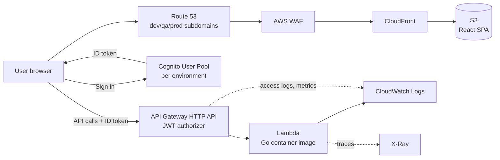

# ADR 0001: Serverless Go and React Platform on AWS

- **Status:** Proposed
- **Date:** 2026-11-21
- **Amended:** 2026-11-21. Scope is the proof, not a Django replacement. Dropped Aurora, the Lambda VPC, and the Cognito Identity Pool. Amazon API Gateway is an HTTP API, and it is used only when deployed. Runtime configuration of the SPA is decided in [ADR 0002](0002-proof-application.md).
- **Revised:** 2026-11-21, after review. API Gateway answers CORS. X-Ray traces Lambda only. Idle cost has a fixed WAF and Route 53 baseline. The database decision no longer cites an Aurora capacity floor.
- **Author:** Glenn Bach
- **Scope:** AWS platform for the proof, a Go API and a React SPA with no product domain. The application itself is [ADR 0002](0002-proof-application.md).

---

## Context

This repository holds the proof: a browser interface that calls a Go API. It is not a replacement for an existing product, and it stores nothing.

The deployment goals are:

- Low cost when idle. Pay per use where possible.
- Little infrastructure to maintain. Prefer managed and serverless services.
- Clear isolation between dev, QA, and prod, including user identities.
- Repeatable, reviewable infrastructure defined in code.
- Consistency with existing Caltech IT practice for secrets and logging.

### Architecture summary

- **Frontend:** React single-page app (SPA) hosted on Amazon S3 and served through Amazon CloudFront. AWS WAF protects it, and Amazon Route 53 provides custom domains.
- **API:** A Go service packaged as a container image and run on AWS Lambda, behind Amazon API Gateway. This is the AWS product, used only in the cloud. The API is an HTTP API. A JWT authorizer validates the Cognito ID token before any request reaches Lambda. The HTTP API's CORS configuration answers browser preflight requests.
- **Identity:** Amazon Cognito User Pool, one pool per environment. No Identity Pool.
- **Data:** None. The proof has no database.
- **Delivery:** AWS CodePipeline and CodeBuild. Images are stored in Amazon ECR.
- **Operations:** CloudWatch structured logs, API Gateway access logs and metrics, and AWS X-Ray tracing of Lambda. Secrets Manager and SSM Parameter Store are the practice when a secret exists. This proof has none.

Compute is serverless and costs nothing at idle. The edge and DNS resources bill a small fixed monthly amount. See the cost baseline under Consequences.

Local development does not use this diagram. The laptop runs the Go server and the SPA dev server, and it does not call AWS. See ADR 0002.

---

## Decisions

### 1. Infrastructure as Code: AWS CDK in Python

**Decision.** All infrastructure is defined with AWS CDK in Python, which synthesizes to CloudFormation. This includes Cognito, Route 53, CloudWatch, WAF, API Gateway, Lambda, S3, CloudFront, CodePipeline, CodeBuild, and ECR.

**Rationale.**
- This is a single, standalone app. It has no dependency on existing Terraform state.
- Python is more readable and easier to compose than CloudFormation YAML.
- CloudFormation manages state, so there's no separate state file to store, lock, or protect, and no lock-in to third-party providers.

**Alternatives considered.**
- *Terraform:* The team already knows it, but this app gains nothing from shared state or modules, and Terraform adds state-backend management.
- *Raw CloudFormation (YAML/JSON):* It is verbose, has weak abstraction, and is harder to review.

**Consequences.**
- (+) One language for infrastructure logic, with real constructs, loops, and tests.
- (+) No state file to manage.
- (−) Developers who mostly know Terraform will need some time to learn CDK. We accept this minor cost.
- (−) We inherit CloudFormation's limits, such as stack resource limits, slower rollbacks, and drift handling.
- **Note:** Cognito pools and the Route 53 zone need careful stack layout. Each environment gets its own user pool, and all environments share one hosted zone, which lives in its own stack.

---

### 2. Authentication: Amazon Cognito User Pool

**Decision.** Cognito handles sign-in for deployed environments. The React app uses the Cognito Hosted UI and receives an ID token. The API Gateway HTTP API validates that token with a JWT authorizer before any request reaches the Go Lambda. Each environment (dev, QA, prod) gets its own User Pool. There is no Identity Pool.

**Rationale.**
- A User Pool is a managed, AWS-native identity service, and an HTTP API can check its tokens with a JWT authorizer.
- Rejecting unauthenticated requests at the edge keeps them off the backend.
- Separate pools isolate users, so QA users never appear in prod.
- An Identity Pool exists to trade a token for temporary AWS credentials so browser code can call AWS APIs. This proof's browser calls only its own API.

**Alternatives considered.**
- *Cognito Identity Pool in each environment:* Rejected for this proof. It would add a second identity system the application does not call. A later app can add one when browser code needs AWS credentials.
- *One shared User Pool for all environments:* Rejected because it mixes test and production identities.
- *Validating JWTs in the Go app on AWS:* Possible, but it duplicates work API Gateway already does and lets unauthenticated traffic reach Lambda. Local development does not use a token at all. See ADR 0002.
- *REST API with a Cognito user-pool authorizer:* Rejected in favor of an HTTP API. The proof needs a checked token and the claims. Usage plans, API keys, and mapping templates would sit unused. On an HTTP API, Lambda receives the claims at `requestContext.authorizer.jwt.claims`.
- *Third-party IdP (Auth0, Okta) as the primary mechanism:* It adds a vendor and cost. Federation into Cognito, for example with campus SSO, remains an option later.

**Consequences.**
- (+) On AWS, the backend can trust that a request which reached it passed the JWT authorizer. The Go code reads the `email` claim.
- (+) Environment isolation for users.
- (−) Pool settings must stay consistent across environments, which CDK handles.
- (−) Some Cognito settings, such as certain attributes, can't be changed after a pool is created. The proof needs `email` on the ID token. Design that schema up front.
- (−) Local development does not sign in and does not call Cognito. See ADR 0002.

---

### 3. CI/CD: AWS CodePipeline + CodeBuild

**Decision.** A Git push to the build branch triggers CodePipeline. A CodeBuild step:
- builds the Go container image and pushes it to Amazon ECR, and
- builds the React production bundle once (`npm install`, production build).

The bundle does not embed environment-specific endpoints. Deploy writes a `config.json` for each environment, as decided in ADR 0002. Both artifacts come from the same source commit and deploy together.

Stages:
- **Dev:** Deploys automatically on every push to `main`, with no approval gate.
- **QA:** Deploys after dev.
- **Prod:** Requires a manual approval action (see Decision 4).

We will not use Git tags to trigger prod deploys.

**Rationale.**
- It's AWS-native, defined in CDK alongside the rest of the stack, and needs no external CI credentials.
- Building both artifacts from one commit keeps the frontend and API in sync.
- One bundle means the bytes promoted through QA are the bytes that reach prod.
- Manual approval is enough control for this proof and quicker to set up than tag-based release flows.

**Alternatives considered.**
- *GitHub Actions:* Capable, but it needs cross-account credentials or OIDC setup and keeps pipeline definitions outside CDK.
- *Git tag–triggered prod releases:* More ceremony than this proof needs.
- *A separate React build per environment:* Rejected in ADR 0002. QA would not have run the prod bundle.

**Consequences.**
- (+) One pipeline definition, versioned with the infrastructure.
- (+) Fast feedback in dev.
- (+) The JavaScript bundle is identical in dev, QA, and prod.
- (−) Each environment's bucket carries its own `config.json`, and that file needs a short cache lifetime.

---

### 4. QA-to-prod promotion: Manual approval in CodePipeline

**Decision.** A manual approval action sits between the QA and prod stages in CodePipeline.

**Rationale.** It's simple, and the approval record (who approved and when) is auditable enough for this proof.

**Alternatives considered.**
- *Automatic promotion after QA tests:* Not justified until there is solid automated test coverage.
- *Tag-based or release-branch promotion:* More process than needed.

**Consequences.**
- (+) Clear human gate before prod, with an audit trail.
- (−) Releases depend on an approver being available.
- (−) Approvals expire after 7 days if no one acts, so the pipeline needs to be re-run in that case.

---

### 5. Database: none

**Decision.** The proof stores nothing. The AWS stacks do not create Aurora or any other database. The repository has no database container.

**Rationale.** There is no data to store. A database the application never connects to would be another resource in each environment to secure, pay for, and keep in sync.

**Alternatives considered.**
- *Aurora Serverless v2 (MySQL-compatible):* The earlier proposal for a relational app. Deferred until an application has rows to store. It remains a candidate at that point because of MySQL compatibility. Evaluate its idle cost and network placement then, against the engine versions current at that time.
- *A checked-in compose file that daily development does not run:* Rejected. A file that nobody is meant to run will be run, and it will be stale by the time a schema exists.
- *Amazon DocumentDB, or a provisioned RDS instance:* Not chosen for this proof, and not the default when a database is eventually needed.

**Consequences.**
- (+) No idle database cost. Lambda does not run in a VPC.
- (+) No connection pooling, RDS Proxy, or local MySQL to operate.
- (−) The first app that stores data has to add a database, local and in AWS, at that time.

---

### 6. Secrets: AWS Secrets Manager and SSM Parameter Store

**Decision.** When a value is secret, it is stored in Secrets Manager. Less sensitive configuration can live in SSM Parameter Store. Secrets are never hardcoded in CDK code or stored in plaintext Lambda environment variables.

This proof has no secret values. The Cognito client id, User Pool id, Hosted UI domain, and API base URL are public in the SPA's `config.json`. Non-secret process settings, such as `AUTH_MODE`, may be Lambda environment variables. The allowed CORS origin is part of the HTTP API's configuration, which CDK sets.

**Rationale.** This matches existing Caltech IT practice for the day a secret exists. It supports rotation, IAM-scoped access, and CloudTrail records of access. The proof does not invent a secret so that the practice has something to store.

**Alternatives considered.**
- *Plaintext Lambda environment variables or CDK context for actual secrets:* Rejected because they are insecure and hard to rotate.
- *Putting the public Cognito settings in Secrets Manager:* Rejected. They ship to the browser anyway.

**Consequences.**
- (+) The rule is in place before the first secret.
- (+) The proof's Lambda does not pay a secret fetch on cold start.
- (−) A later secret needs a fetch path and a cache in the execution environment.

---

### 7. Observability: CloudWatch structured logs + AWS X-Ray

**Decision.** The Go Lambda writes structured (JSON) logs to CloudWatch Logs, the existing Caltech IT standard. Lambda has X-Ray active tracing enabled. The HTTP API writes access logs to CloudWatch Logs and publishes CloudWatch metrics. HTTP APIs do not support X-Ray, so traces start at Lambda.

**Rationale.** Structured logs can be queried with CloudWatch Logs Insights. Lambda traces show cold starts, duration, and errors. API Gateway access logs and metrics show latency, status codes, and authorizer rejections. An access log entry and a Lambda trace can be joined on the request id.

**Alternatives considered.**
- *Third-party APM or log platforms:* These add cost and another vendor, and they don't follow the current standard.
- *REST API, to get API Gateway segments in X-Ray:* Rejected in Decision 2. Access logs and metrics cover what the proof needs to see at API Gateway.

**Consequences.**
- (+) Consistent with existing operations practice. No new tools to learn.
- (−) There is no single X-Ray trace from API Gateway through Lambda. A request is followed by its request id.
- (−) Each environment needs log retention policies to control cost.
- (−) X-Ray sees application detail only when the Go code instruments it, through the X-Ray SDK or OpenTelemetry/ADOT.

---

### 8. Edge security and DNS: AWS WAF + CloudFront + Route 53

**Decision.**
- An AWS WAF web ACL sits in front of the CloudFront distribution for the public React app.
- Route 53 provides a custom domain. **One shared hosted zone** holds a subdomain for each environment (dev, QA, prod), each pointing at that environment's CloudFront distribution.
- Raw CloudFront URLs are not used.

**Rationale.** WAF provides managed protection at the edge. Custom domains give stable, readable URLs and work with the Cognito callback and logout URLs.

**Alternatives considered.**
- *A separate hosted zone per environment:* Needs extra delegation with little benefit for this app.
- *No WAF:* Not appropriate for a public endpoint.

**Consequences.**
- (+) Consistent URLs and edge protection.
- (−) A WAF web ACL used with CloudFront must be created in `us-east-1`, and so must the ACM certificate. The CDK stacks need to handle this across regions.
- (−) The shared hosted zone is a resource all environments depend on and must be deployed and protected separately.
- (−) The browser calls API Gateway on a separate origin from the SPA, and the `Authorization` header makes the browser send a preflight `OPTIONS` first. The HTTP API's CORS configuration allows that environment's SPA origin, method `GET`, and header `Authorization`. API Gateway answers the preflight itself, with no `OPTIONS` route. Go sets no CORS headers, because API Gateway ignores backend CORS headers once CORS is configured. See ADR 0002.

---

### 9. Environments: dev, QA, and prod on AWS, plus local development

**Decision.**
- **Local:** Day-to-day coding on Mac laptops. The Go server and the Vite dev server run on the host. This environment does not call AWS and does not sign in. See ADR 0002.
- **Dev on AWS:** A shared environment that deploys automatically on push to `main`, for testing real AWS behavior, including the JWT authorizer.
- **QA on AWS:** Pre-production validation.
- **Prod on AWS:** Promoted with manual approval.
- Each environment has its own Cognito User Pool. The Route 53 hosted zone is shared.

**Rationale.** Local development keeps iteration fast and does not depend on AWS. The shared dev environment catches problems that only show up on AWS, such as IAM and authorizer behavior, before QA.

**Consequences.**
- (+) Clear promotion path and isolation.
- (+) Local work needs no AWS account activity.
- (−) Three copies of the remaining stack. There is no database floor under them.
- (−) Behavior that depends on API Gateway or Cognito is invisible until a deploy.

---

## Consequences (overall)

**Positive**
- Pay-per-use compute with automatic scaling and little to operate. Idle cost is a small fixed baseline (below).
- Repeatable, reviewable infrastructure in Python CDK.
- Strong isolation between environments for user identities.
- The laptop can build and run the application without AWS.

**Negative and risks**
- Lambda cold starts for container images. Measure them, and add provisioned concurrency only if needed.
- Resources that must live in `us-east-1` (the CloudFront WAF and ACM certificate) and resources shared by all environments (the hosted zone) make stack layout more complex.
- The team needs to learn CDK.
- Sign-in and the JWT authorizer exist only on AWS, so the deployed path needs a real deploy to prove it.

**Baseline cost at idle**

Assumptions: AWS list prices checked 2026-11-21, standard (not flat-rate) CloudFront pricing, one WAF web ACL per environment, each with three AWS managed rule groups, and one hosted zone.

| Item | Count | Per month |
|---|---|---|
| WAF web ACL ($5.00 each) | 3 | $15.00 |
| WAF rules and rule groups ($1.00 each) | 9 | $9.00 |
| Route 53 hosted zone ($0.50 each) | 1 | $0.50 |
| **Total before any traffic** | | **about $24.50** |

Not included: per-request charges (WAF, CloudFront, API Gateway, Lambda), ECR image storage, CloudWatch Logs storage, and CodePipeline runs. At proof traffic these are expected to be small, but they are not zero.

## Open questions and follow-ups

1. Federate campus SSO into the Cognito User Pools?
2. Settle the CDK stack layout: one shared stack for DNS and the `us-east-1` resources, plus one app stack per environment.
3. How long to keep logs in each environment?
4. Use the CloudFront flat-rate Free plan ($0 per distribution)? It includes WAF (5 rules) and DNS, capped at 1M requests and 100 GB per month, with no overage charges. That could remove most of the WAF baseline. Check it against Decision 8's custom domains and `us-east-1` resources before adopting it.
